  <a href="https://github.com/ian-vizcarrrondo/filebuddy"><picture><source media="(prefers-color-scheme: dark)" srcset="assets/filebuddy-dark.svg" /></picture></a>
  <a href="https://github.com/ian-vizcarrrondo/pc-biometrics"><picture><source media="(prefers-color-scheme: dark)" srcset="assets/pulse-dark.svg" /></picture></a>
  <a href="https://ian-vizcarrrondo.github.io/crypto-tweet-bot/"><picture><source media="(prefers-color-scheme: dark)" srcset="assets/cryptodoggy-dark.svg" /></picture></a>

  
  
  
  

 

<picture>
  <source media="(prefers-color-scheme: dark)" srcset="assets/aero-bubbles-dark.svg" />
  <source media="(prefers-color-scheme: light)" srcset="assets/aero-bubbles.svg" />
  
</picture>

<a href="https://x.com/IanVizcarrondo">Find me on X</a>

